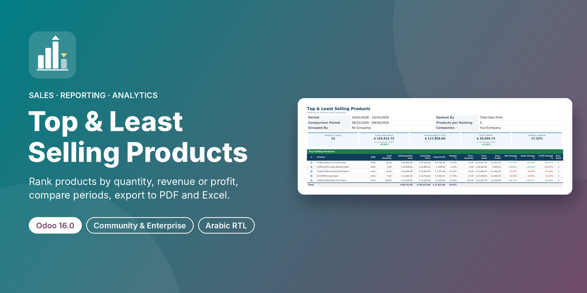

# Top & Least Selling Products Report (Odoo 16.0)



Odoo app that ranks your products from the **best** to the **least** selling, by sold quantity,
total sale price or total profit. It compares any two periods, groups by sales team or
salesperson, and outputs to the browser, a PDF or an Excel file, in English and Arabic (RTL).

**Branches:** **16.0** · [17.0](../../tree/17.0) · [18.0](../../tree/18.0) · [19.0](../../tree/19.0). Each branch holds the module ported to that Odoo version.

| | |
|---|---|
| Odoo version | 16.0, Community and Enterprise |
| Technical name | `top_least_selling_report` |
| Depends on | `sale_management`, `sale_margin` |
| Python dependency | `xlsxwriter` (already part of Odoo's requirements) |
| Menu | Sales › Reporting › Top & Least Selling Products |
| Languages | English, Arabic (`ar_001`, right-to-left PDF and Excel) |
| Automated tests | 31 |
| License | LGPL-3 |

## Features

- **Wizard** under Sales › Reporting; Odoo's own reports are left untouched.
- **Rank by** Sold Quantity, Total Sale Price or Total Profit, with 1 to 1,000 products in each of the top and least sets.
- **Compare with** the previous period, the same period last year or custom dates: previous figures, change %, previous rank and a *New in Period* flag.
- **Group by** Sales Team or Salesperson; the ranking restarts in each group.
- **Filters:** companies, sales teams, salespersons, product categories (with sub-categories).
- **Columns:** Sold Quantity, Unit of Measure, Sold Quantity Cost, Total Sale Price, Total Profit, Margin %.
- **Outputs:** list / pivot / graph views, an A4 landscape PDF with KPI cards, and a formatted `.xlsx`.
- Optionally lists saleable products that did not sell at all.

## How the figures are computed

Confirmed sales orders only (locked or not), read through the standard Sales Analysis
(`sale.report`) and aggregated in PostgreSQL. Quantities are in each product's reference
unit of measure, amounts are untaxed in the company currency, cost is the cost stored on the
sales order line, and Total Profit = Total Sale Price − Sold Quantity Cost.

## Installation

1. Put the `top_least_selling_report` folder in your addons path, or add this repository
   (branch `16.0`) as an addons path / Odoo.sh submodule.
2. Update the apps list and install **Top & Least Selling Products Report**.
3. Open **Sales › Reporting › Top & Least Selling Products**.

## Running the tests

```
odoo-bin -d <database> -i top_least_selling_report --test-enable \
    --test-tags /top_least_selling_report --stop-after-init
```

## Author and support

**Ibrahim Yahia** · [LinkedIn](https://www.linkedin.com/in/ibrahim-yahia) · ibrahim.yahiah@gmail.com

Licensed under LGPL-3.
